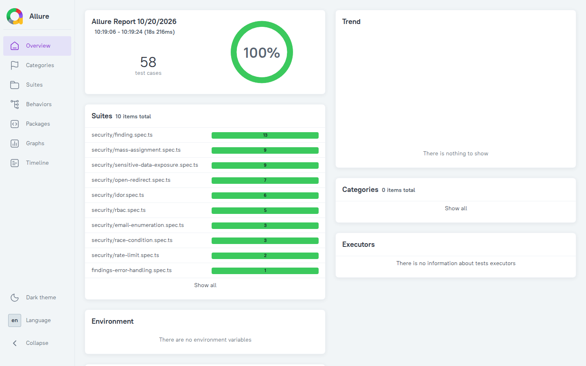
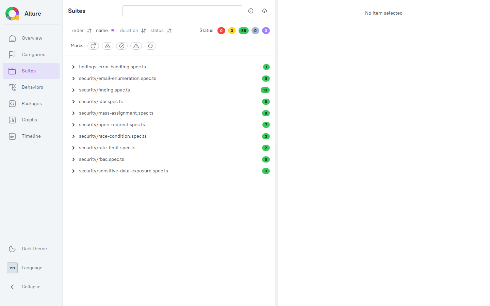
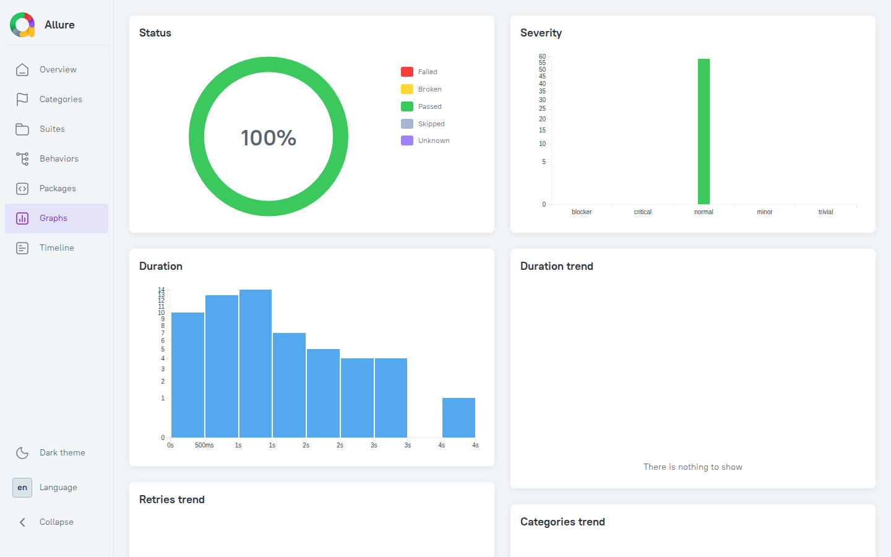

# Security Test Report

## 1. Overview

This project is a **QA Security Playground** designed to demonstrate practical security testing, vulnerability reproduction, security fixes, automated security regression testing, and CI/CD integration.

The security test suite is implemented using **Playwright** and covers common web application security scenarios.

The project currently contains **58 automated security tests** covering:

* IDOR / Broken Access Control
* Rate Limit
* Email Enumeration
* Open Redirect
* Race Condition
* Finding & Scoring
* Mass Assignment
* Sensitive Data Exposure
* Role-based Access Control / Privilege Escalation
* Error Handling (generic 500 responses)

Allure is used to generate a visual test report from the Playwright execution results.

### Security Test Summary

| Security Area                | Test Cases | Result      |
| ---------------------------- | ---------: | ----------- |
| IDOR / Broken Access Control |          6 | PASS        |
| Rate Limit                   |          2 | PASS        |
| Email Enumeration            |          3 | PASS        |
| Open Redirect                |          7 | PASS        |
| Finding & Scoring            |         13 | PASS        |
| Race Condition               |          3 | PASS        |
| Mass Assignment              |          9 | PASS        |
| Sensitive Data Exposure      |          9 | PASS        |
| RBAC / Privilege Escalation  |          5 | PASS        |
| Findings error handling      |          1 | PASS        |
| **Total**                    |     **58** | **58 PASS** |

---

# 2. IDOR / Broken Access Control

## Vulnerability

Insecure Direct Object Reference (IDOR) occurs when an application exposes an object through a predictable identifier without properly verifying whether the requesting user is authorized to access that object.

### Attack Scenario

Alice owns Order #1.

Bob is authenticated with his own session and attempts to access:

```http
GET /api/orders/1
Cookie: qa_session=<Bob's signed session>
```

A client-supplied `X-User-ID` header is not trusted and grants no access.

### Vulnerable Behavior

The vulnerable implementation allows Bob to retrieve Alice's order.

```text
Bob → GET /api/orders/1
       ↓
   Order #1
       ↓
    HTTP 200
```

### Security Fix

The API identifies the current user from the signed `qa_session` cookie and verifies that the requested order belongs to that user. Ownership is always enforced; the former `IDOR_SECURITY_FIX` toggle was removed.

```text
if order.userId !== sessionUserId
    → HTTP 403 Forbidden
```

### Expected Security Behavior

| Scenario                     | Expected |
| ---------------------------- | -------: |
| Alice accesses Alice's order |      200 |
| Bob accesses Alice's order   |      403 |
| Bob accesses Bob's order     |      200 |
| Missing session              |      401 |
| Forged `X-User-ID` header    |      401 |
| Invalid order ID             |      400 |

### Automated Test

```text
tests/security/idor.spec.ts
```

Result:

**6 passed**

---

# 3. Rate Limit

## Vulnerability

An authentication endpoint may be vulnerable to brute-force attacks when repeated failed login attempts are not properly rate limited.

### Attack Scenario

An attacker repeatedly sends invalid login credentials.

```text
Attempt 1 → 401
Attempt 2 → 401
Attempt 3 → 401
Attempt 4 → 401
Attempt 5 → 401
Attempt 6 → 429
```

### Security Control

The current playground implementation enforces:

```text
5 attempts / 60 seconds
```

The limit is tracked per email address and stored in PostgreSQL (`LoginRateLimit`, created by `sql/login-rate-limit.sql`), so counters survive server restarts and are shared across instances. A transaction-scoped advisory lock serializes concurrent attempts for the same email, and a successful login clears the counter. Passwords are verified against bcrypt hashes.

Requests exceeding the threshold receive:

```http
HTTP 429 Too Many Requests
```

### Automated Test

```text
tests/security/rate-limit.spec.ts
```

The test sends seven failed logins for a unique email (`rate-limit-<timestamp>@lab.test`) and asserts the exact sequence `401 ×5, 429 ×2`. A unique email per run means the test cannot lock out seeded accounts or collide with earlier runs.

Result:

**2 passed**

A second test sends 10 concurrent failed logins for another unique email and asserts exactly five `401` and five `429`, verifying that the advisory lock prevents concurrent requests from bypassing the limit.

> The limiter is keyed by email only (not by IP) and expired rows are not purged automatically. This is intentionally simplified for the local security playground.

---

# 4. Email Enumeration

## Vulnerability

Email enumeration occurs when an application reveals whether an email address exists in the system.

A vulnerable response may expose information such as:

```json
{
  "exists": true
}
```

while a non-existing account may return:

```json
{
  "exists": false
}
```

This allows an attacker to identify registered accounts.

### Security Fix

The endpoint returns a generic response regardless of account existence.

```json
{
  "exists": false,
  "message": "If the email is registered, further action is required."
}
```

### Expected Security Behavior

Existing and non-existing email addresses should not be distinguishable through the API response.

### Automated Test

```text
tests/security/email-enumeration.spec.ts
```

Covered scenarios: existing and non-existing emails are indistinguishable; an invalid JSON body returns `400`; invalid email values (non-string or empty) return `400`.

Result:

**3 passed**

---

# 5. Open Redirect

## Vulnerability

An open redirect occurs when an application accepts an attacker-controlled URL and redirects users to an external domain.

Example:

```text
/api/redirect?url=https://evil.example.com
```

### Vulnerable Behavior

The vulnerable implementation redirects the request to the attacker-controlled domain.

```text
Application
    ↓
https://evil.example.com
```

### Security Fix

Only internal relative paths are accepted.

Allowed:

```text
/dashboard
/profile
/settings
```

Blocked:

```text
https://evil.example.com
//evil.example.com
javascript:alert(1)
```

### Expected Security Behavior

| Input                 | Expected |
| --------------------- | -------: |
| External URL          |      400 |
| Protocol-relative URL |      400 |
| JavaScript URL        |      400 |
| Internal path         |      307 |
| Missing URL           |      400 |
| Backslash / encoded slash / whitespace path | 400 |

The validator also rejects `/\evil.example.com`, encoded `%2f`/`%5c`, control characters and whitespace, because browsers may normalize a backslash to a slash.

### Automated Test

```text
tests/security/open-redirect.spec.ts
```

Result:

**7 passed**

---

# 6. Race Condition

## Vulnerability

A race condition can occur when multiple concurrent requests perform a check and update as separate operations.

### Vulnerable Flow

The vulnerable implementation performs:

```text
1. Read usedCount
2. Check usedCount < maxUses
3. Wait
4. Update usedCount
5. Create redemption
```

Two concurrent requests can observe the same state.

```text
Request A → usedCount = 0
Request B → usedCount = 0

Request A → passes check
Request B → passes check

Request A → redemption succeeds
Request B → redemption succeeds
```

For a coupon with:

```text
maxUses = 1
```

this violates the intended business rule.

### Security Fix

The fixed implementation performs the usage check and increment atomically in PostgreSQL:

```sql
UPDATE "Coupon"
SET "usedCount" = "usedCount" + 1
WHERE "code" = $1
  AND "usedCount" < "maxUses"
RETURNING
  "id",
  "code",
  "discount",
  "usedCount",
  "maxUses"
```

The update is executed inside a PostgreSQL transaction together with the redemption insert.

### Expected Security Behavior

Two concurrent requests should produce:

```text
Request A → 200
Request B → 409
```

The response order is not important.

The important security invariant is:

```text
successful redemptions <= maxUses
```

### Automated Test

```text
tests/security/race-condition.spec.ts
```

The test logs in as two separate users (Alice and Bob, each with their own session) and sends two requests concurrently. The redeeming user is taken from the session, not the request body:

```ts
Promise.all([
  aliceRequest.post(...),
  bobRequest.post(...),
]);
```

It verifies:

```text
[200, 409]
```

and validates the database state:

```text
usedCount = 1
usedCount <= maxUses
```

Two further tests cover repeated redemption:

* Redeeming a coupon that is already fully used is rejected.
* The same user redeeming a coupon twice while uses remain gets `409 Conflict`
  (the unique-constraint violation `23505` is mapped to a clean error instead of a `500`).

Result: **3 passed**.

### Test Isolation

Each test creates a unique coupon and removes it afterward.

This prevents the test from depending on the state of the deterministic application seed.

The test has been independently executed multiple times:

```text
Run #1 → PASS
Run #2 → PASS
Run #3 → PASS
```

---

# 7. Finding & Scoring

The project contains a finding submission and scoring mechanism.

A security finding contains:

* User
* Challenge
* Severity
* Evidence
* Correct/incorrect classification

### Automated Tests

```text
tests/security/finding.spec.ts
```

Covered scenarios:

Findings are created and read for the authenticated session user. A `userId` in the request body cannot impersonate another user.

| Scenario                                    |          Expected |
| ------------------------------------------- | ----------------: |
| Correct Rate Limit finding                  |         Score 100 |
| Incorrect finding                           |           Score 0 |
| Correct Email Enumeration finding           |         Score 100 |
| Unauthenticated submission                  |          Rejected |
| Forged `userId` in body                     |   Not impersonated |
| Result returns latest finding of session user |    Latest finding |
| Another user's finding                      |      Not exposed |
| Unauthenticated challenge result request    |          Rejected |
| Unknown challenge slug                      |               404 |
| Invalid severity                            |          Rejected |
| Evidence over 5000 characters               |          Rejected |
| Empty evidence                              |          Rejected |
| Client-supplied `isCorrect: true`           | Ignored (stored false) |

Result:

**13 passed**

---

# 8. Automated Security Test Architecture

The security tests are organized as:

```text
tests/
├── findings-error-handling.spec.ts
└── security/
    ├── config/
    │   └── test-data.ts
    ├── helpers/
    │   ├── security.ts
    │   └── session.ts
    ├── idor.spec.ts
    ├── rate-limit.spec.ts
    ├── email-enumeration.spec.ts
    ├── open-redirect.spec.ts
    ├── race-condition.spec.ts
    ├── mass-assignment.spec.ts
    ├── rbac.spec.ts
    ├── sensitive-data-exposure.spec.ts
    └── finding.spec.ts
```

The tests focus on observable security behavior rather than implementation details.

Examples:

```text
Unauthorized access → 403
Missing authentication context → 401
Rate limit exceeded → 429
Unsafe redirect → 400
Race condition → only one successful redemption
```

---

# 9. Security Testing Approach

The project combines:

* Positive security testing
* Negative security testing
* Boundary testing
* Authorization testing
* API security testing
* Concurrency testing
* Database state validation
* Automated regression testing

The general workflow is:

```text
Security Risk
      ↓
Manual Reproduction
      ↓
Security Test Scenario
      ↓
Automated Test
      ↓
Security Fix
      ↓
Regression Test
      ↓
Allure Report
      ↓
CI/CD Validation
```

The goal is not only to reproduce a vulnerability but also to verify that the corresponding security control remains effective after future changes.

---

# 10. Allure Security Reporting

The project uses Allure as a reporting layer for Playwright security tests.

Reporting flow:

```text
Playwright
    ↓
allure-playwright
    ↓
allure-results/
    ↓
allure-commandline
    ↓
allure-report/
```

The report can be generated with:

```bash
npm run allure:generate
```

For local preview:

```bash
npm run allure:serve
```

Then access:

```text
http://localhost:8080
```

Generated Allure artifacts are excluded from version control. In CI the report is uploaded as the `allure-security-report` artifact (retained for 14 days).

### Visual Evidence

Screenshots taken from the Allure report generated for the run in section 14
(58 tests, 100% pass rate, 10 suites).

**Overview**



**Suites** (one per security area; 58 passed, 0 failed, 0 broken, 0 skipped)



**Graphs**



---

# 11. Mass Assignment

## Vulnerability

Mass Assignment occurs when an application binds client-supplied fields to
sensitive model attributes without restricting which fields may be changed.

## Reproduction Evidence

The vulnerable profile endpoint accepted a request containing `isAdmin: true`
and changed Alice's database record from `isAdmin = false` to `isAdmin = true`.

The behavior was reproduced using curl and verified directly against PostgreSQL.

## Remediation

The endpoint now requires an authenticated session and updates only the
explicitly permitted `name` field. The acting user is taken from the signed
`qa_session` cookie, so a client-supplied `userId` is ignored. Client-supplied
`isAdmin` and `isVerified` fields are not included in the SQL update query.

## Automated Regression Tests

- Protected attributes remain unchanged when included in a malicious request.
- A normal profile name update succeeds.
- Alice cannot update Bob by forging `userId`.
- A tampered session cookie is rejected (`401`).
- Requests without a valid session are rejected (`401`).
- An expired session cookie is rejected (`401`).
- A correctly signed session without a `jti` claim is rejected (`401`).
- Empty, whitespace-only, and over-100-character names are rejected (`400`).

Each test creates its own temporary user (with a bcrypt-hashed password) and
deletes it afterward, so the per-email login rate limit cannot couple tests.

**Result:** 9/9 tests passed.

## Remaining Risk

Sessions are HMAC-signed cookies carrying a `jti` claim, and logout revokes the
`jti` server-side (see section 12). There is still no rotation or idle timeout.
This lab app is not production-ready.

---

# 12. Sensitive Data Exposure

## Vulnerability

Sensitive Data Exposure occurs when API responses reveal secrets or internal
details such as passwords, password hashes, tokens, stack traces, or
parser errors.

## Security Controls

* Login responses contain only a message and `userId`.
* Failed logins return a generic `Invalid credentials` error.
* Missing, non-string, or empty login fields return `400`.
* The `qa_session` cookie is `HttpOnly`, `SameSite=Lax`, `Path=/`, `Max-Age=3600`
  (and `Secure` in production).
* Logout expires the cookie and records the session's `jti` in `RevokedSession`
  (`sql/session-revocation.sql`). A copied token is rejected (`401`) after logout.
  Session lookup fails closed: if the revocation table cannot be queried, the
  request is treated as unauthenticated. Logout returns `503` if revocation fails.
* Malformed JSON sent to `/api/findings` returns `400 Invalid JSON body`.
* Unexpected server errors return a generic `Failed to create finding`
  message; details are logged server-side only.

## Automated Tests

```text
tests/security/sensitive-data-exposure.spec.ts
```

| Scenario                         | Expected Result                                  |
| -------------------------------- | ------------------------------------------------ |
| Successful login                 | No password, hash, token, or user object exposed |
| Failed login                     | Generic error; submitted password not echoed     |
| Invalid JSON body                | `400` with no `detail` or `stack` fields         |
| Missing login fields             | `400`                                            |
| Non-string email                 | `400`                                            |
| Empty password                   | `400`                                            |
| Session cookie after login       | HttpOnly, SameSite=Lax, Path=/, Max-Age=3600     |
| Logout                           | Cookie cleared                                   |
| Copied session token after logout | `401` (server-side revocation)                  |

### Test Isolation

Login rate-limit counters live in PostgreSQL (see section 3). The rate-limit
test uses a unique email per run, so it cannot lock out the seeded Alice and
Bob accounts used by other tests.

### Error Handling Verification

The generic `500 Failed to create finding` response is verified by
`tests/findings-error-handling.spec.ts`. The findings POST handler was moved to
`src/lib/findings/handler.ts` as a factory with injected dependencies, so the
test can supply a mock database whose `Finding.create` throws an error
containing internal SQL details. The test asserts that:

* the response is `500` with exactly `{ "error": "Failed to create finding" }`
* the response does not contain the internal error message or a stack trace
* the error is logged server-side once

This is a handler-level test with a mock database, not an end-to-end request
against a running server. It lives in `tests/`, outside `tests/security/`.

**Result:** 9/9 Sensitive Data Exposure tests and 1/1 error-handling test passed.

---

# 13. Role-based Access Control / Privilege Escalation

## Vulnerability

Privilege escalation occurs when a regular user can reach administrator-only
functionality, either directly or by modifying their own privilege attributes.

## Security Controls

`GET /api/admin/users` enforces the following checks in order:

| Condition                      | Response |
| ------------------------------ | -------: |
| No valid session               |      401 |
| Session user not in database   |      401 |
| User is not an administrator   |      403 |
| User is an administrator       |      200 |

* The acting user comes from the signed `qa_session` cookie.
* `isAdmin` is read from the database on every request, not stored in the cookie,
  so revoking admin rights takes effect immediately.
* The check is strict (`isAdmin === true`), so any other value is denied.
* The response lists id, email, name, role flags, and creation time; the
  `password` field is never selected.

## Automated Tests

```text
tests/security/rbac.spec.ts
```

| Scenario                                          |                Expected |
| ------------------------------------------------- | ----------------------: |
| Unauthenticated request                           |                     401 |
| Regular user                                      |                     403 |
| Admin user                                        | 200, no password fields in any row |
| Valid session for a deleted user                  |  401, "User not found" |
| Mass-assign `isAdmin: true`, then call admin API  |   403, DB `isAdmin` false |

### Test Isolation

Each test creates a regular user and an admin user with unique IDs and deletes
them afterward. Sessions are signed directly, so the per-email login rate limit
is not consumed.

**Result:** 5/5 tests passed.

## Known Limitations

* The endpoint returns at most 100 users.

---

# 14. Security Test Results

The complete automated security test suite currently contains:

**58 security tests**

Latest confirmed execution:

```text
Running 58 tests using 6 workers

58 passed (19.4s)
0 failed
```

Execution time:

```text
19.4s
```

Run date: 2026-10-19, against a freshly started local Next.js dev server and
seeded PostgreSQL database. The visual evidence for this run is in section 10.

### Final Result

**58/58 security tests passed**

---

# 15. CI/CD Integration

The security test suite is integrated into GitHub Actions.

The CI pipeline performs:

1. Checkout source code
2. Setup Node.js
3. Install dependencies
4. Install Playwright browsers
5. Initialize PostgreSQL (Prisma schema)
6. Apply `sql/*.sql` (`LoginRateLimit`, `RevokedSession`)
7. Seed deterministic test data
8. Start the application
9. Probe API routes (unauthenticated requests must return `401`)
10. Execute security tests (`npx playwright test`, 58 tests)
11. Generate the Allure report
12. Upload the report as the `allure-security-report` artifact

The pipeline is intended to function as a security regression gate so that security-related regressions can be detected during CI execution.

---

# 16. Current Coverage

Current implemented security scenarios:

| Security Area                | Status      |
| ---------------------------- | ----------- |
| IDOR / Broken Access Control | Implemented |
| Rate Limit                   | Implemented |
| Email Enumeration            | Implemented |
| Open Redirect                | Implemented |
| Race Condition               | Implemented |
| Finding & Scoring            | Implemented |
| Playwright Automation        | Implemented |
| Allure Reporting             | Implemented |
| GitHub Actions CI            | Implemented |
| Mass Assignment              | Remediated  |
| Session Authentication       | Implemented |
| Password Hashing (bcrypt)    | Implemented |
| Sensitive Data Exposure      | Implemented |
| Session Revocation (logout)  | Implemented |
| Persistent Login Rate Limit  | Implemented |
| RBAC / Privilege Escalation  | Implemented |

---

# 17. Future Improvements

Planned improvements include:

* Server-side session revocation and rotation
* Expanded API security scenarios
* Expanded CI security gates
* Security test evidence and attachments
* AI-assisted security test generation
* Automated security test case generation from requirements
* AI-assisted security test result summarization

---

# 18. Conclusion

The QA Security Playground demonstrates an end-to-end security testing workflow:

```text
Identify Vulnerability
        ↓
Reproduce Attack
        ↓
Define Expected Security Behavior
        ↓
Implement Security Fix
        ↓
Create Automated Security Test
        ↓
Validate Application Behavior
        ↓
Generate Allure Report
        ↓
Run Security Regression Tests
        ↓
Integrate With CI/CD
```

The current implementation successfully validates:

**58 automated security tests with 0 failures.**

The project is intentionally designed as a learning and portfolio environment rather than a production security platform.
